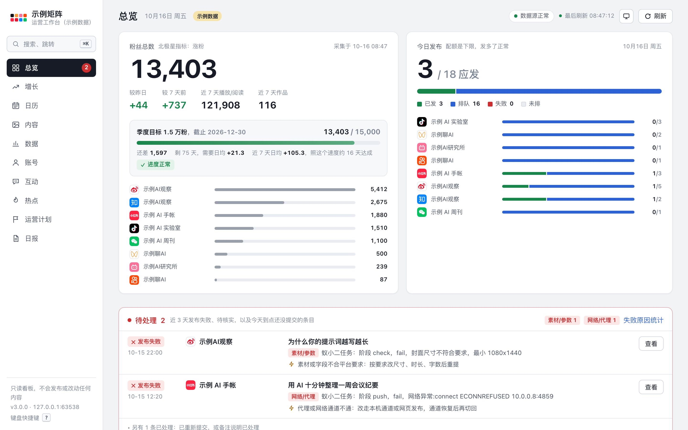
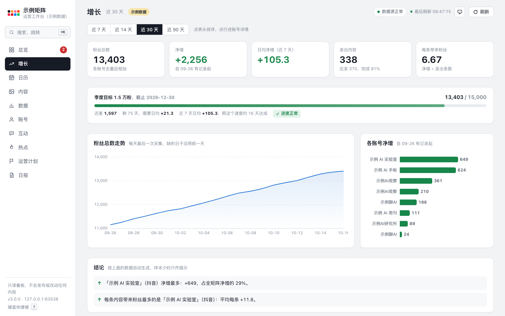
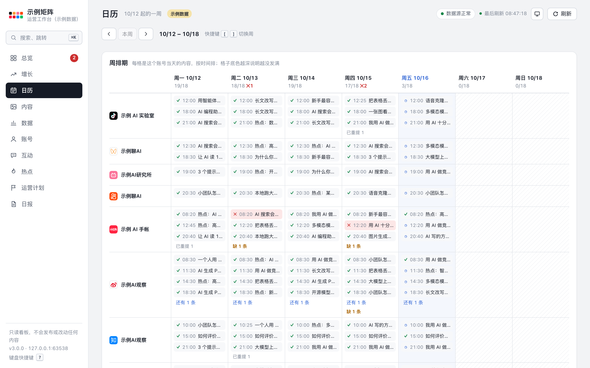
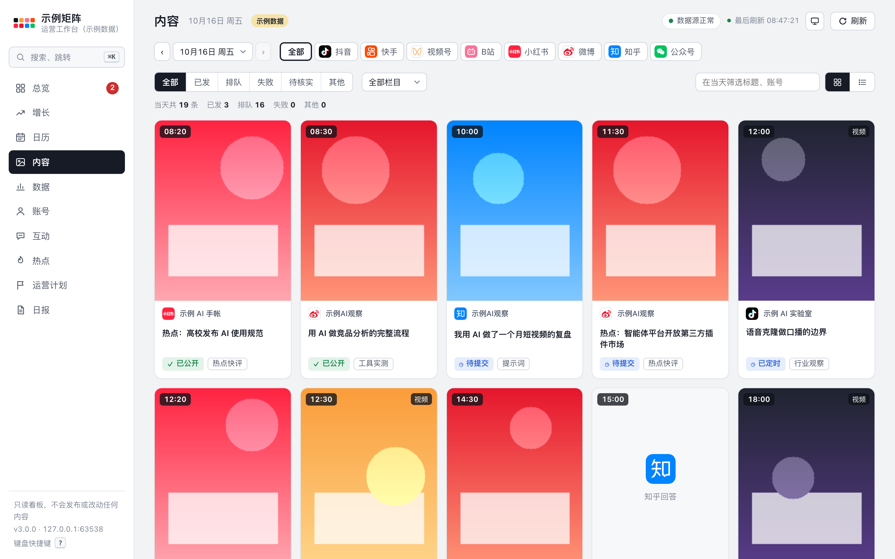
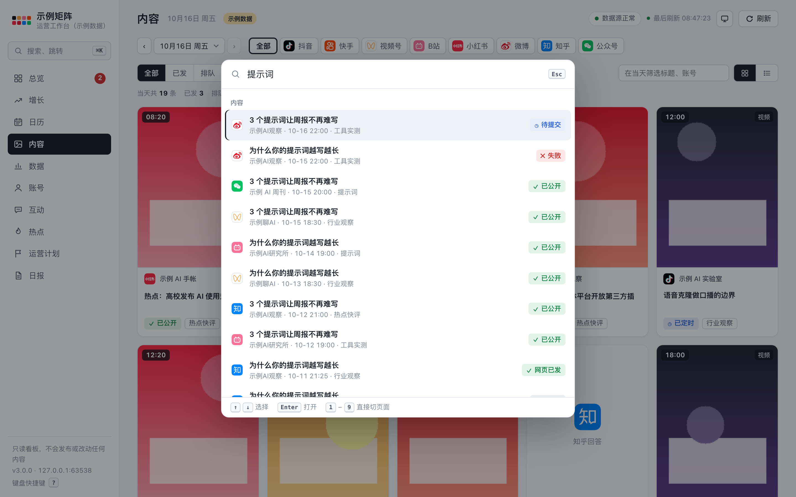
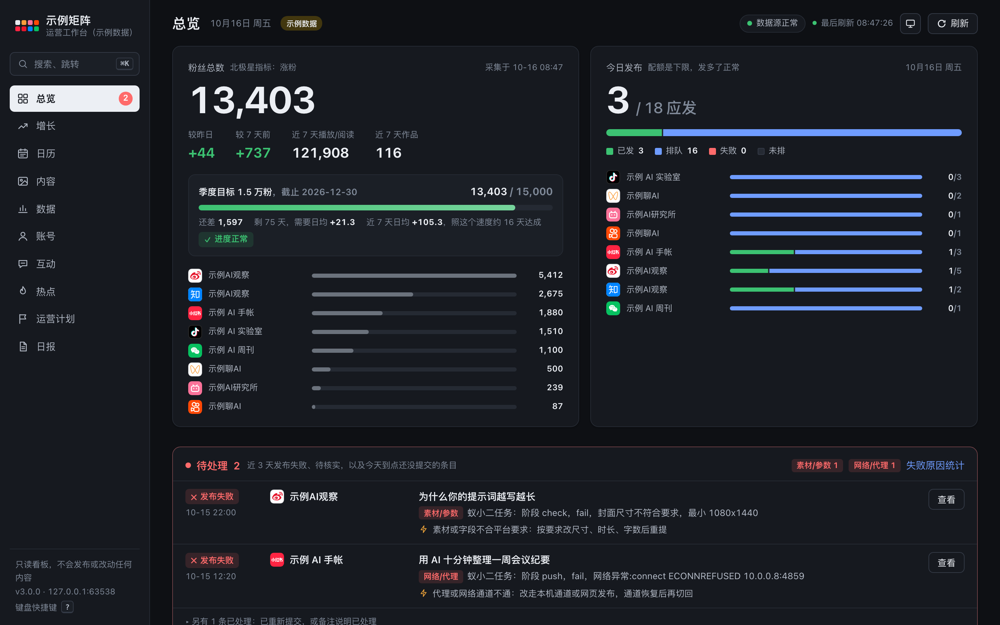
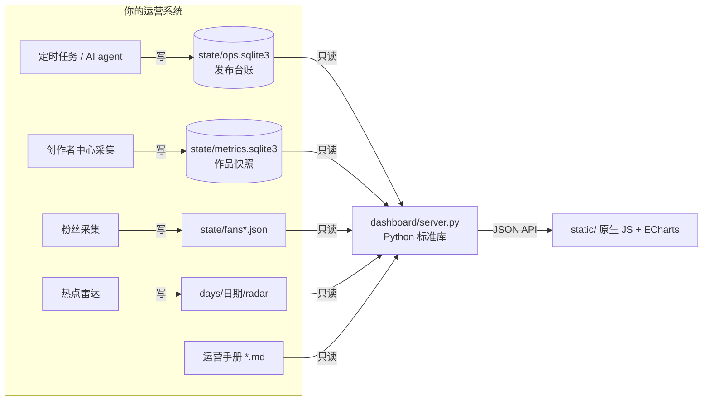

# 矩阵运营工作台 · matrix-ops-dashboard

> 一个人 + AI 运营一整个自媒体矩阵时用的本地看板。零依赖，示例数据一行命令就能跑起来。
>
> A zero-dependency, local, read-only dashboard for running a multi-platform Chinese social-media matrix (Douyin, WeChat Channels, Xiaohongshu, Weibo, Zhihu, Bilibili, Kuaishou, WeChat Official Accounts) with AI agents. Python stdlib + vanilla JS, no build step. Try it with `python3 dashboard/server.py --demo`.



## 为什么做这个

用 AI 定时任务同时运营 8–10 个账号以后，每天要回答的问题变成了：

- 今天该发的发出去没有？哪条失败了，**为什么**失败，下一步怎么处理？
- 粉丝在涨吗？离目标还有多远？**哪个号值得继续投入**？
- 这周的排期有没有空档？哪个号这个月老是发不满？
- 规则改了几次？定时任务有没有在跑？哪个数据源已经停了？

各平台的创作者中心只能一个号一个号地看，发布工具也只管发。这个工作台把发布台账、作品数据、粉丝、热点、实验和运营手册放在同一个地方看，并且**只读**：它不发布、不互动，也不碰任何账号。

## 快速开始

```bash
git clone <本仓库>
cd matrix-ops-dashboard
python3 dashboard/server.py --demo
# 打开 http://127.0.0.1:8790
```

不用装依赖（Python 3.9+ 就行）。`--demo` 会生成 8 个虚构账号、21 天的示例数据，所有页面都能点。

接入自己的数据：按 [数据目录约定](dashboard/README.md#数据目录约定) 把发布台账、作品数据、粉丝写进对应的 sqlite 和 json 文件，然后运行：

```bash
python3 dashboard/server.py --root /path/to/your/ops --port 8790
```

## 功能

| | |
|---|---|
|  | **增长**：粉丝走势、目标进度（按近 7 天速度预测达成日）、各账号净增。投入产出表算每条涨粉、每千播放涨粉、完成率、失败数，并自动写出结论 |
|  | **日历**：周排期（账号 × 7 天）、30 天发布心跳、每天的发布成功率，失败原因自动归成 6 类并附处理建议 |
|  | **内容**：每条内容的成品图、视频、文案、审稿记录、作品数据和流程记录。抽屉里可以用 ← → 切换，地址可以直接分享 |
|  | **⌘K 命令面板**：搜内容标题、日报、手册全文，跳到任意页面或账号。数字键切页，`[` `]` 切日期 |

另外还有：作品数据（留存、栏目、时段，KPI 可和上一期对比，可导出 CSV）、互动额度、热点雷达、运营手册浏览、A/B 实验看板、版本时间线、日报、数据源健康检查、深浅色主题，手机上也能用。



## 架构



- 服务端是一个 Python 文件，只用标准库；sqlite 用只读模式打开；默认只监听 127.0.0.1。
- 前端没有框架，也没有构建步骤。图表用本地的 ECharts，动效用浏览器原生的 Web Animations API。
- 某个数据源坏了只影响对应那一块，其他照常显示。

## 方法论

工作台只是观察层。背后是一套让 AI 定时任务稳定执行运营规则的做法：单一规则入口、规则优先级、薄提示词、作废规则体检、数据驱动的每日和每周进化、防小样本误判的判断口径。写在 [docs/methodology.md](docs/methodology.md)，里面也记了我们踩过的坑。

## 隐私和安全

- 默认只监听本机。`--host 0.0.0.0` 会把数据暴露给局域网，启动时会提醒。
- `/files/` 只放行数据目录 `days/`、`assets/` 下的图片和 mp4，路径穿越会返回 404。
- 接口返回前会把字段名像 token、cookie、secret 的值打成 `***`。
- 仓库里的截图和示例数据全是虚构的。

## 常见问题

**支持哪些平台？** 平台标识内置了抖音、快手、视频号、B站、小红书、微博、知乎、公众号。别的平台照样能显示，只是没有品牌图标。

**发布失败的原因是怎么归类的？** 用报错文字做规则匹配（登录失效、网络/代理、账号配置、审核/风控、素材/参数、超时），规则在 `server.py` 的 `FAIL_RULES`，可以按自己用的发布工具改。

**能不能拿来发布？** 不能，这个仓库是只读看板。发布由你自己的工具或脚本负责，工作台只读它们写下的台账。

## 许可

代码采用 [MIT](LICENSE)。第三方组件（ECharts、simple-icons、Remix Icon）的许可见 [THIRD_PARTY_NOTICES.md](THIRD_PARTY_NOTICES.md)。各平台的名称和商标归各自所有，这里只用来区分平台。
