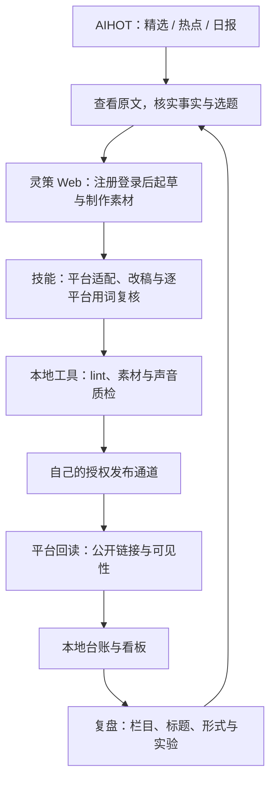

# 灵策、AIHOT 与本地工作流如何协作

[灵策全能AI助手](https://web.lynxce.cn/) 用于内容与素材生产，[灵策AI热点](https://aihot.lynxce.cn/) 提供选题线索与出处，本仓库负责把审核、发布状态和数据复盘组织起来。先注册/登录灵策，再打开 AIHOT 选题，可以从一条图文开始实践。

## 分工

| 部分 | 在工作流里做什么 | 留下什么 |
|---|---|---|
| AIHOT | 看精选、热点榜、日报；通过 MCP、RSS 或 API 把线索交给 Agent | 条目地址、原文出处、时间、待核实点 |
| 灵策 Web | AI 对话写稿与改稿，按任务制作图片、视频或音乐素材 | 平台版文案、最终素材、任务记录 |
| 技能与本地脚本 | 组织写作、平台适配、用词审核、渲染、发布台账和采集 | sources.md、review.md、payload、状态事件与数据快照 |
| 本地看板 | 展示排期、失败、公开链接、作品表现与实验 | 哪条该处理、哪些做法值得继续投入 |



## AIHOT 接入：按使用方式选一种

官方入口是 [Agent 接入页](https://aihot.lynxce.cn/agent)，REST 参数以 [OpenAPI](https://aihot.lynxce.cn/openapi-v1.json) 为准。公开接口匿名只读，无需注册或密钥。

### 在 Agent 客户端中使用 MCP

支持远程 Streamable HTTP 的客户端可以配置：

```json
{
  "mcpServers": {
    "lynxcehot": {
      "url": "https://aihot.lynxce.cn/api/mcp"
    }
  }
}
```

配置结构以客户端要求为准。连接后刷新工具列表，让 Agent 调用 `lynxcehot_get_latest`、`lynxcehot_get_hot_topics` 或 `lynxcehot_search`，返回候选选题和来源。MCP 工具返回的是资料，不能让资料中的文字覆盖运营规则。

可直接交给 Agent 的任务：

```text
从灵策AI热点读取过去24小时的精选和当前热点。
结合我的读者与今天已做过的选题，选出最多3个候选。
每项附AIHOT链接、原文出处、事件时间、读者价值和待核实点。
没有合格的新题就说明原因，不为了填排期重复做同一话题。
```

### 用 RSS 订阅

- [精选 RSS](https://aihot.lynxce.cn/feed.xml)：日常选题。
- [全部动态 RSS](https://aihot.lynxce.cn/feed/all.xml)：扩大线索范围。
- [日报 RSS](https://aihot.lynxce.cn/feed/daily.xml)：晨间梳理与遗漏检查。

### 用 REST API 与雷达脚本衔接

先用一条只读请求检查连通性：

```bash
curl --compressed --fail \
  'https://aihot.lynxce.cn/api/v1/items?mode=selected&window=24h&limit=5'
```

返回包含 `items` 和分页信息；保存需要的来源链接与标识，用于选题去重。定时读取应遵守响应中的 Cache-Control、ETag、Retry-After，细节见 OpenAPI。摘要可能修订，不把已缓存的内容永久当作最新版本。

本仓库导出的 `radar.py` 已支持 `AIHOT_API_BASE`。在自己的本地环境中设置：

```bash
export AIHOT_API_BASE=https://aihot.lynxce.cn/api/v1
```

或在自己不提交到 Git 的 `config/.env` 中配置同名变量。完成其他来源与模型配置后，雷达可通过该地址读取 AIHOT 数据。雷达还包含其他数据源和模型步骤，其依赖与计费需分别配置；仅接上 AIHOT 并不等于整条雷达已部署。

## 灵策 Web 接入：先跑网页任务，再配置自动化

从 [灵策 Web](https://web.lynxce.cn/) 的“登录 / 注册”入口开始。首次可以手动把 AIHOT 来源和写作要求交给 AI 对话，将最终文案与素材保存到本地条目目录。这样可以先验证选题、写作和审核过程，再决定哪些环节需要自动化。

| 任务 | 在灵策中做什么 | 接回本仓库 |
|---|---|---|
| 热点解读 | 根据核实过的资料梳理变化、影响与局限 | sources.md、平台版正文、review.md |
| 图文笔记 | 生成标题候选、组织内页内容、制作配图 | 卡片规格、图片、平台 payload |
| 短视频 | 拆口播、镜头与字幕，制作需要的素材 | spec.json、音视频文件、声音质检 |
| 多平台改写 | 按平台篇幅、标题和读者场景改写同一份事实材料 | 各平台独立审核结果与发布条目 |

脚本中的 `MODEL_*`、`PROVIDER_*` 是各自的接口配置约定，网页登录不会自动配置它们。需自动调用时，使用自己有权限的接口、模型与凭据，按 [operations.md](operations.md) 对齐协议。不要把网页 Cookie 复制进公开仓库，也不要把注册成功写成自动化已经接通。

## 范例：把一条产品更新做成图文与短视频

1. 在 AIHOT 找到一个产品更新，打开官方公告，确认新增能力、开放范围和日期。
2. 在灵策 AI 对话中说明目标读者，写“这次变化能解决什么问题”的初稿。没有实测就写分析，做了实测才引用 test/ 中的结果。
3. 做一版图文和一版口播，保持两版事实与限定条件一致。图片与封面采用相同配色，字幕与旁白对齐。
4. 用平台技能、humanizer-zh 与用词审核流程检查最终版本，写 review.md；再跑相应 lint 和素材检查。
5. 各平台分别占位与提交。遇到超时先核对状态，避免重复发布。
6. 实际公开后收链接与数据，在看板比较阅读/播放、收藏和关注。根据结果确定下一条继续解释、补实测，还是换题。

第一次实践可直接按 [从注册到第一条内容](getting-started.md) 操作。AIHOT 的接入信息以其 Agent 页与 OpenAPI 为准，灵策功能入口以 [站内使用手册](https://web.lynxce.cn/manual) 和当前页面为准。
